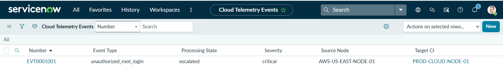
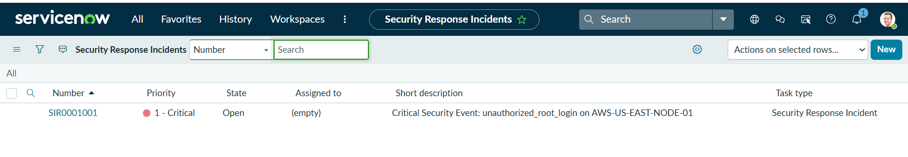
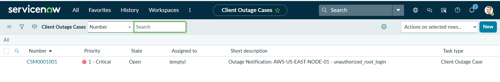

# Autonomous Cloud Outage & Security Threat Response Hub (ServiceNow)

## 📌 Executive Overview
An automated, cross-module enterprise incident and security orchestration platform built on ServiceNow (Scoped Application: `Autonomous Cloud Outage and Security Hub` / `x_2317706_autono_0`). This solution bridges **Event Management (CIS-EM)**, **Security Incident Response (CIS-SIR)**, **Customer Service Management (CIS-CSM)**, and **CMDB Data Foundations (CIS-DF)** to detect critical infrastructure threats, isolate compromised servers, and notify impacted clients in real time.

---

## 🏗️ Solution Architecture & Workflow

```text
[Cloud Telemetry Event (x_2317706_autono_0_cld_event)]
   │  Ingests Critical Alert (e.g., Unauthorized Root Login / DDoS Anomaly)
   ▼
[After-Insert Business Rule] ──► Invokes [OutageSecurityOrchestrator (Script Include)]
   ├──► 1. Event Management (CIS-EM) ──► Updates Event Processing State to "Escalated"
   ├──► 2. Security Incident (CIS-SIR) ─► Creates SIR Ticket with MITRE Tactic Tagging
   ├──► 3. Global CMDB (cmdb_ci_server) ─► Flips Server Operational Status to "Non-Operational"
   └──► 4. Client Outage Case (CIS-CSM) ─► Generates CSM Case for Proactive Client Notification
```

---

## 🗄️ Data Model & Schema Design

| Table Label | Backend Table Name | Extends | Purpose & CIS Alignment |
| :--- | :--- | :--- | :--- |
| **Cloud Telemetry Event** | `x_2317706_autono_0_cld_event` | Base Table | Ingests infrastructure alerts (`source_node`, `event_type`, `severity`, `target_ci`) with `EVT` auto-numbering (**CIS-EM**). |
| **Security Response Incident** | `x_2317706_autono_0_sec_resp` | `Task [task]` | Tracks threat category, `mitre_tactic`, `containment_status`, and `source_event` with `SIR` numbering (**CIS-SIR**). |
| **Client Outage Case** | `x_2317706_autono_0_out_case` | `Task [task]` | Manages external customer impact (`client_account`, `outage_summary`, `case_status`) with `CSM` numbering (**CIS-CSM**). |
| **Server CI** | `cmdb_ci_server` | `cmdb_ci_computer` | Reflects real-time server health (`Operational` vs. `Non-Operational`) via Cross-Scope Privileges (**CIS-DF**). |

---

## 🧪 Verified Test Execution Results
1. **Critical Alert Ingestion:** Submitted event `EVT0001001` (`Source Node: AWS-US-EAST-NODE-01`, `Event Type: Unauthorized Root Login`, `Severity: Critical`) targeting `PROD-CLOUD-NODE-01`.
2. **Automated Escalation:** Event automatically transitioned to `escalated` processing state.
3. **SecOps & CMDB Isolation:** Auto-generated Security Response Incident (`SIR`) with MITRE ATT&CK classification and flipped `PROD-CLOUD-NODE-01` operational status to `Non-Operational` in `cmdb_ci_server`.
4. **Proactive Customer Case:** Auto-generated linked Client Outage Case (`CSM`) to streamline external stakeholder communication.

---

## 📸 Implementation Proof & Screenshots

### 1. Escalated Cloud Telemetry Event (`x_2317706_autono_0_cld_event`)


### 2. Automated Security Response Incident (`x_2317706_autono_0_sec_resp`)


### 3. Proactive Client Outage Case (`x_2317706_autono_0_out_case`)


### 4. CMDB Server CI Isolation (`cmdb_ci_server`)


